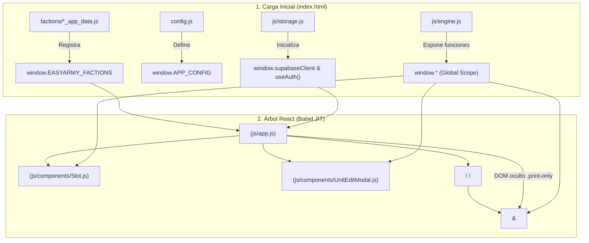

# 📘 ARMY MAKER — Documento Maestro de Arquitectura y Contexto Técnico (Living Document)

> **⚠️ REGLA DE DOCUMENTO VIVO (PUNTO DE PARTIDA OBLIGATORIO):**
> 1. **Punto de partida:** Este archivo (`PROJECT_MANUAL.md`), junto con `AGENTS.md`, es la fuente única de verdad (*Single Source of Truth*) y el contexto base obligatorio al iniciar cualquier conversación o tarea de desarrollo sobre este proyecto.
> 2. **Actualización continua obligatoria:** Cualquier modificación, nueva funcionalidad, corrección de errores (*bugfix*), cambio de arquitectura o actualización de datos que se implemente en el proyecto **DEBE quedar registrada en este documento** en el mismo turno de trabajo (actualizando tanto la sección técnica afectada como la **[Sección 8: Registro Vivo de Cambios (Changelog)](#8-registro-vivo-de-cambios-changelog)**).

---

## 1. Visión General

### 1.1. Propósito del Proyecto
**ARMY MAKER** es una aplicación web progresiva (**PWA**) de tipo *Single-Page Application* (**SPA**) diseñada para construir, validar, gestionar y exportar listas de ejército (*rosters*) para el wargame histórico de miniaturas **Bolt Action: Tercera Edición (v3)**.

### 1.2. Qué Problema Resuelve
1. **Reemplazo moderno y rápido de constructores clásicos (EasyArmy):** Mantiene el **100% de paridad reglamentaria y nomenclatura en inglés** de *EasyArmy (`wg.easyarmy.com`)*, pero con una interfaz reactiva moderna, sin recargas de página, apta para móviles/tablets en mesa de juego y con validación en tiempo real.
2. **Cero fricción de ejecución (*Zero-Build Runtime*):** No requiere un paso de compilación (*bundling*) para ejecutarse en producción ni para desplegarse en servidores estáticos (GitHub Pages).
3. **Generación de hojas de torneo y cartas de batalla A4:** Automatiza el desglose balístico de armas por escuadra/vehículo, filtra únicamente las reglas especiales activas y genera **Tarjetas de Unidad (*Battle Cards* / cromos de `90mm × 50mm`)** listas para imprimir o descargar en PDF.
4. **Persistencia híbrida Offline/Cloud:** Permite trabajar 100% sin conexión (mediante `localStorage` y *Service Worker*) o sincronizar listas entre dispositivos mediante **Supabase (PostgreSQL + Auth + RLS)**.

### 1.3. Funcionamiento Básico
- El usuario elige una **Facción** (Alemania, Unión Soviética, EE. UU., Gran Bretaña, Japón, Italia o Francia) en la barra superior.
- Gestiona uno o varios **Pelotones** (*Rifle, Heavy Weapons, Engineer, Artillery, Armoured, Recce*) organizados en una cuadrícula de **5 columnas** de casillas (*slots*) obligatorias y opcionales.
- Al pulsar una casilla vacía (`[+]`), se despliega un buscador con las unidades permitidas según el catálogo de esa casilla y periodo histórico.
- Al seleccionar o pulsar una unidad equipada, se abre el **Modal de Configuración (`UnitEditModal`)** a dos columnas, donde se ajusta la veteranía (*Inexperienced, Regular, Veteran*), soldados adicionales y opciones de armamento, validando en vivo las restricciones reglamentarias.
- Permite **arrastrar y soltar (*Drag-to-Copy*)** unidades entre casillas compatibles (con ratón o pulsación larga táctil en móviles), guardar en local/nube y exportar el *roster* completo a **PDF A4**.

---

## 2. Stack Tecnológico

### 2.1. Entorno de Ejecución en Cliente (Frontend Runtime — CDN / Zero-Build)
Cargado directamente desde `index.html` sin empaquetador:

| Capa | Tecnología / Librería | Versión / Origen | Rol en el Sistema |
| :--- | :--- | :--- | :--- |
| **Lenguaje** | JavaScript (ES2022+) + JSX | Nativo / Babel | Lógica del motor, estado, componentes e integración con APIs. |
| **UI Framework** | React + ReactDOM (UMD) | `18.x` (`unpkg.com`) | Renderizado declarativo y hooks (`useState`, `useEffect`, `useMemo`, `useRef`, `useCallback`). |
| **Transpilador JIT** | `@babel/standalone` | Latest (`unpkg.com`) | Compila en el navegador los archivos `<script type="text/babel">`. |
| **Estilos** | Tailwind CSS (Play CDN) + CSS nativo | v3 CDN + `css/styles.css` | Utilidades de diseño, tema militar personalizado y reglas `@media print` A4. |
| **Tipografía** | Google Fonts | `Inter`, `Chakra Petch`, `JetBrains Mono` | `Inter` (UI/tablas), `Chakra Petch` (cabeceras tácticas), `JetBrains Mono` (puntos, dados y perfiles). |
| **Exportación PDF** | `html2pdf.js` | `0.10.1` (`cdnjs`) | Empaqueta `html2canvas` + `jsPDF` para rasterizar y paginar el *roster* en formato A4 retrato. |
| **Backend-as-a-Service** | `@supabase/supabase-js` | `v2` (`jsdelivr`) | Autenticación (`email`/`password`) y persistencia CRUD sobre PostgreSQL. |
| **PWA / Offline** | Web App Manifest + Service Worker | Nativo (`sw.js` caché `army-maker-v16`) | Instalación standalone y caché híbrida (*Network-First* / *Stale-While-Revalidate*). |

### 2.2. Entorno de Desarrollo, Servidor y Scraping (Node.js ESM)
Definido en `package.json` (`"type": "module"`):

| Herramienta / Paquete | Versión | Propósito |
| :--- | :--- | :--- |
| **Node.js** | `>= 18.x` (con `fetch` nativo, `node:vm`, `node:http`, `node:zlib`) | Ejecución del servidor local (`server.js`), suite de verificación (`verify_easyarmy.js`), generador de iconos (`make_icons.js`), demonio Git (`auto_sync.js`) y *scraper*. |
| **`cheerio`** | `^1.2.0` (`devDependencies`) | Parsing de DOM HTML en `scraper/parse.js` para extraer plantillas de pelotón y perfiles de unidades de EasyArmy. |
| **`vite`** | `^8.3.4` (`devDependencies`) | Servidor estático alternativo opcional (`vite.config.js`), aunque el proyecto prioriza `server.js` nativo. |

---

## 3. Arquitectura y Estructura

### 3.1. Árbol de Directorios Principal

```text
ARMYMAKER-main/
├── AGENTS.md                         # Reglas de contexto automático para agentes IA (apunta a PROJECT_MANUAL.md)
├── PROJECT_MANUAL.md                 # Documento Maestro Vivo de arquitectura, lógica y registro de cambios
├── ARCHITECTURE.md                   # Resumen ejecutivo de arquitectura y escalabilidad
├── README.md                         # Presentación del repositorio y enlaces rápidos
├── index.html                        # Punto de entrada SPA, configuración Tailwind, carga ordenada de scripts
├── config.js                         # Configuración pública de Supabase (window.APP_CONFIG)
├── manifest.webmanifest              # Metadatos PWA (standalone, orientación, colores, iconos)
├── sw.js                             # Service Worker (CACHE = 'army-maker-v16')
├── server.js                         # Servidor HTTP nativo Node.js (puertos 5173 y 3000) + arranque de auto_sync
├── vite.config.js                    # Configuración mínima de Vite (puerto 5173)
├── package.json                      # Scripts npm (dev, start, preview, sync, test) y devDependencies
├── start.bat                         # Lanzador rápido para Windows (ejecuta node server.js)
├── auto_sync.bat                     # Lanzador independiente del demonio de sincronización Git
│
├── css/
│   └── styles.css                    # Estilos base, safe-areas PWA, scrollbars y maquetación @media print A4
│
├── js/
│   ├── engine.js                     # Motor puro JS: cálculo de puntos, tablas balísticas y validación de unidades
│   ├── storage.js                    # Cliente Supabase, fallback LocalStorage y hook React useAuth()
│   ├── icons.js                      # Componentes SVG inline, HelmetLogo e insignias tácticas OTAN (Unit/Platoon)
│   ├── app.js                        # Componente raíz <App /> y montaje en #root
│   └── components/
│       ├── Modals.js                 # <ModalShell>, <AuthModal>, <SavedListRow>, <MyListsModal>, <ExportModal>
│       ├── Slot.js                   # <Slot>: casilla de pelotón, buscador desplegable y Drag & Drop (HTML5 + Touch)
│       ├── UnitEditModal.js          # <QuantityStepper> y <UnitEditModal>: configurador completo de unidad
│       └── ArmyRosterPrintView.js    # <ArmyRosterPrintView> y <UnitTacticalCard>: hoja A4 y cromos 90x50mm
│
├── factions/                         # Datasets modulares por facción (7 grandes potencias implementadas)
│   ├── germany_app_data.js           # Registra window.EASYARMY_FACTIONS['germany'] (216 unidades)
│   ├── soviet_union_app_data.js      # Registra window.EASYARMY_FACTIONS['soviet_union'] (124 unidades)
│   ├── usa_app_data.js               # Registra window.EASYARMY_FACTIONS['usa'] (128 unidades)
│   ├── great_britain_app_data.js     # Registra window.EASYARMY_FACTIONS['great_britain'] (148 unidades)
│   ├── japan_app_data.js             # Registra window.EASYARMY_FACTIONS['japan'] (94 unidades)
│   ├── italy_app_data.js             # Registra window.EASYARMY_FACTIONS['italy'] (72 unidades)
│   ├── france_app_data.js            # Registra window.EASYARMY_FACTIONS['france'] (39 unidades)
│   └── <faction>.json / <faction>.md # Datasets JSON estructurados y manuales de referencia en Markdown
│
├── images/
│   └── units/                        # Ilustraciones locales de unidades (.jpg / .png), en raíz y subcarpetas por facción
│
├── icons/                            # Activos gráficos PWA generados por scripts/make_icons.js
│   ├── favicon.svg
│   ├── icon-192.png
│   ├── icon-512.png
│   ├── icon-maskable-512.png
│   └── apple-touch-icon.png
│
├── scripts/
│   ├── verify_easyarmy.js            # Auditoría automatizada de integridad de facciones vs EasyArmy (npm test)
│   ├── auto_sync.js                  # Watcher fs.watch con debounce (8s) que ejecuta git add/commit/push automático
│   └── make_icons.js                 # Rasterizador procedural PNG (4x4 supersampling + zlib) y generador SVG
│
├── scraper/                          # Pipeline de extracción y compilación de datos desde wg.easyarmy.com
│   ├── client.js                     # Cliente HTTP con sesión autenticada, cookies, throttling y caché en disco
│   ├── parse.js                      # Parsers Cheerio para NewPlatoon, Platoon (5 columnas) y Unit
│   ├── scrape.js                     # Crawler de plantillas y unidades por countryID
│   ├── download_images.js            # Descargador masivo de imágenes de unidades hacia images/units/
│   ├── build_<faction>.js            # Compiladores que transforman scraper/out/<id>/ en factions/<faction>.*
│   ├── fetch.js                      # Utilidad CLI de depuración para descargar HTML crudo
│   ├── list_countries.js             # Lista los countryID disponibles en EasyArmy
│   ├── list_german_templates.js      # Lista plantillas v3 de Alemania para inspección
│   ├── state.json                    # Almacena el GUID de la lista temporal usada por el scraper
│   └── out/                          # Datos crudos extraídos por countryID (1, 2, 4, 5, 10, 18) -> templates/*.json
│
└── supabase/
    └── schema.sql                    # DDL PostgreSQL: tabla public.army_lists, índices, triggers de cuota y políticas RLS
```

### 3.2. Explicación Detallada de Archivos Críticos

#### A. Núcleo y Configuración
- **`index.html`**: Define la configuración extendida de Tailwind (paleta cromática militar `zinc-50..950`, `amber-50..600`, `tacticalRed: '#733028'`), registra el Service Worker con recarga automática en `controllerchange`, expone los hooks de React en `window` y carga secuencialmente:
  1. Librerías CDN (`React`, `ReactDOM`, `Babel`, `html2pdf`, `supabase-js`).
  2. Módulos de datos (`./factions/*_app_data.js`).
  3. `./config.js`.
  4. Scripts JS puros (`./js/engine.js`, `./js/storage.js`).
  5. Scripts JSX transpilados por Babel (`./js/icons.js`, `./js/components/*.js`, `./js/app.js`).
- **`css/styles.css`**: Gestiona variables visuales críticas:
  - Clases `.safe-top`, `.safe-bottom`, `.safe-x` con `env(safe-area-inset-*)` para pantallas con *notch*.
  - Prevención de auto-zoom en iOS (`font-size: 16px !important` en inputs para `@media (max-width: 640px)`).
  - Reglas `@media print`: fuerza página `@page { size: A4 portrait; margin: 8mm 8mm 10mm 8mm; }`, oculta `.no-print` y maqueta `.unit-cards-grid` en 2 columnas exactas de `90mm` con tarjetas `.unit-card-cromo` de `90mm × 50mm`.

#### B. Capa Lógica (`js/`)
- **`js/engine.js`**: Motor determinista en JavaScript puro (compatible tanto con navegador como con Node.js vía `_root = window || globalThis`). No depende de React. Contiene:
  - `LEGACY_UNIT_ALIASES`: Mapa de traducción de nombres antiguos en español a nombres canónicos en inglés.
  - `getUnitDefinition(factionData, unitName)`: Devuelve la ficha de la unidad o un objeto *fallback* seguro si no existe.
  - `getUnitBaseMen(def)`: Extrae mediante expresiones regulares sobre `def.composition` el número base de miniaturas (excluyendo vehículos).
  - `calculateUnitPoints(def, config)`: Calcula el coste total en puntos de una unidad según experiencia, soldados extra y opciones (`checkbox`, `counter`, `per_man`).
  - `getUnitSummary(def, config)`: Genera el resumen textual de efectivos (`headCountText`, `compositionSummary`) y la lista desglosada de opciones activas con su delta de puntos.
  - `findUnitWeaponRow(def, regex, fallback, excludeRegex)`: Busca perfiles balísticos en `def.weaponsTable` evitando falsos positivos (p. ej. excluye `assault|anti-tank|automatic` al buscar un `Rifle` estándar).
  - `buildUnitRosterTable(def, config)`: Construye las filas exactas (`qty`, `weapons`, `range`, `shots`, `pen`, `special`, `isChassis`) para tres arquetipos:
    1. **Vehículos y Transportes (`isVehicle`)**: Selección inteligente de variante de chasis (p. ej. lanzallamas OT vs estándar), filtrado de MMG en casco eliminadas o *pintle mounts* opcionales, e inyección de mejoras (*Recce*, *Schürzen*, *Reinforced Front Armour*, *Gyro-stabiliser*, *Command Vehicle*).
    2. **Artillería y Equipos de Armas (`isTeamOrArtillery`)**: Cañones, obuses, morteros, MMG, francotiradores, rifles AT, PIAT, perros antitanque, con soporte para modos de disparo alternativos (`(Alt. mode)`), *Spotter* y *Gun shield*.
    3. **Escuadras de Infantería y Mandos (`Case 3`)**: Separa al líder (`NCO`, `Officer`, `Commissar`, `Medic`, `Forward Observer`) con su arma específica (SMG, *Assault rifle*, carabina, pistola, *Shin Gunto*) del resto de soldados (`remainingDefaultMen`), restando dinámicamente los soldados que reemplazan su arma base por `Assault rifle`, `BAR`, `Shotgun`, `SMG`, `Pistol`, `LMG`, `Flamethrower`, `Light mortar` o `AT rifle`, y añadiendo filas adicionales para armas complementarias (*Panzerfaust*, *PIAT*, *VB Launcher*, granadas AT, cargas de demolición) y mejoras de regla (*Stubborn*, *Fanatics*, *Tough fighters*, *Body Armour*, *Skis*, *Cavalry*, *Infiltrators*, *Guard Dog*).
  - `validateUnitConfiguration(def, config)`: Motor de validación reglamentaria en tiempo real. Calcula `dynamicMaxes` por opción y detecta:
    - **Error A:** Exceso de reemplazos de armas sobre el número de soldados rasos disponibles (`totalRankAndFileReplacements > availableRankAndFile`).
    - **Error B:** Opciones tipo `counter` que superan la capacidad dinámica restante o el tamaño total de la escuadra.
    - **Error C:** Superación del límite normativo explícito en el texto de la opción (`"Up to X men..."` / `opt.max`) o selección de más de 1 reemplazo de arma principal para el líder (`leaderReplacementsCount > 1`).
    - **Error D:** Armas de equipo (*LMG*, *Flamethrower*) en escuadras con menos de 2 miniaturas totales.
- **`js/storage.js`**:
  - Resuelve la configuración de Supabase (`window.APP_CONFIG` -> `localStorage['boltaction.supabase_config.v1']` -> constantes por defecto).
  - Inicializa `window.supabaseClient`.
  - Gestiona el almacenamiento local de listas (`boltaction.saved_lists.v1`) y sesión local de respaldo (`boltaction.local_user.v1`).
  - Expone el hook `useAuth()` que sincroniza el estado de sesión de Supabase (`onAuthStateChange`) y eventos personalizados locales (`boltaction-auth-change`).
- **`js/icons.js`**:
  - Define iconos UI vectoriales (`Plus`, `Check`, `Trash`, `XIcon`, `Search`, `CopyIcon`, `AlertTriangleIcon`, `DownloadIcon`, `EyeIcon`, `CloudIcon`, `FolderIcon`, `UserIcon`, `LogOutIcon`) y el emblema principal `<HelmetLogo />`.
  - `resolveTacticalIconType(slot, unitName, platoonTypeId)` y `<UnitTacticalIcon />`: Renderiza símbolos tácticos OTAN dinámicos (con puntos superiores de escalón `dots: 1..3`) para `hq`, `armoured_hq`, `infantry`, `engineer`, `medic`, `observer`, `sniper`, `flamethrower`, `mg`, `mortar`, `anti_tank`, `artillery`, `recce`, `transport` y `armoured`.
  - `PLATOON_TACTICAL_INFO` y `<PlatoonTacticalIcon />`: Diccionario bilingüe (`es`/`en`) e iconos OTAN de 3 puntos para los 6 tipos de pelotón.

#### C. Componentes de Interfaz (`js/components/` y `js/app.js`)
- **`js/app.js` (`<App />`)**: Controlador central de estado, barra superior de acciones, selector de facción, barra de pestañas de pelotones con soporte de *drop* directo sobre pestañas, cuadrícula de 5 columnas, notificaciones *toast* y coordinación con `html2pdf.js`.
- **`js/components/Slot.js` (`<Slot />`)**:
  - Renderiza cada casilla de pelotón (distinguiendo casillas obligatorias en rojo táctico `#733028` y opcionales en verde militar `#3D4B35`/`#2A3525`, atenuadas cuando están vacías y resaltadas en ámbar cuando están ocupadas).
  - Filtra unidades prohibidas en casillas obligatorias mediante regex (`/cannot be taken as a compulsory|may never be taken as a mandatory|instead of one of the non-mandatory/i`).
  - Implementa **Drag-to-Copy** dual: API nativa HTML5 (`draggable`, `onDragStart`, `onDragOver`, `onDrop`) y soporte táctil para móviles/tablets mediante pulsación larga de `220ms` (`onTouchStart`, `onTouchMove` con `document.elementFromPoint` y evento global `armymaker:touchdragover`).
- **`js/components/UnitEditModal.js` (`<UnitEditModal />` y `<QuantityStepper />`)**:
  - Editor a pantalla completa dividido en 2 columnas (`lg:col-span-7` izquierda para experiencia, perfil, opciones agrupadas, tabla balística y reglas especiales; `lg:col-span-5` derecha sticky para ilustración de la unidad y desglose de puntos en vivo).
  - Bloquea el botón `Save Unit` y muestra un banner detallado de errores si `validation.isValid === false`.
- **`js/components/Modals.js`**:
  - `<ModalShell />`: Contenedor base reutilizable para modales.
  - `<AuthModal />`: Inicio de sesión, registro, recuperación de contraseña y configuración manual de URL/Key de Supabase (`mode: 'signin' | 'signup' | 'reset' | 'config'`).
  - `<MyListsModal />` y `<SavedListRow />`: Biblioteca unificada que lista tanto las listas en la nube (`cloudLists` de Supabase) como las guardadas en el dispositivo (`localLists` de `localStorage`).
  - `<ExportModal />`: Configuración previa a la exportación (nombre de lista, notas del ejército, conmutadores persistentes `includeUnitRules`, `includeArmyRules`, `includeUnitCards`), botón de descarga directa PDF y vista previa en vivo (`#printable-army-roster-preview`).
- **`js/components/ArmyRosterPrintView.js`**:
  - Renderiza el documento oficial de torneo A4: cabecera, notas, bloques por pelotón con tablas integradas por unidad, glosario filtrado contextualmente (`armyActiveRules` solo incluye reglas presentes en las unidades/armas activas de la lista), reglas nacionales (`factionData.armyRules`) y la sección **Unit Battle Cards**.
  - `<UnitTacticalCard />` y `getUnitCardStats()`: Genera cromos compactos de `90mm × 50mm` con barra rápida de 5 métricas (`IMPACTO`, `DISPAROS`, `ALCANCE`, `MORAL`, `EFECTIVOS`), tabla abreviada de armas, miniatura de `26mm × 26mm` y etiquetas de reglas. Incluye lógica específica de Bolt Action v3 como **restar automáticamente 1 fusilero activo por cada LMG equipada** y añadir la fila `"Cargador LMG (0 disparos, Loader)"`, o separar en vehículos los disparos de armas principales (`Ppal`) de los de ametralladoras (`MGs`).

---

## 4. Lógica y Flujos de Datos

### 4.1. Arquitectura de Interacción de Componentes y Servicios



### 4.2. Gestión del Estado (`<App />` en `js/app.js`)
El estado de la aplicación se mantiene centralizado en el componente raíz `<App />` mediante hooks de React:

- `activeFactionId` (`string`): ID de la facción activa (`'germany'`, `'soviet_union'`, `'usa'`, `'great_britain'`, `'japan'`, `'italy'`, `'france'`). Se persiste en `localStorage['boltaction.last_faction']`.
- `platoons` (`Array<Platoon>`): Estructura principal de la lista en memoria:
  ```javascript
  [
    {
      id: 1,                  // ID numérico incremental único dentro de la lista
      typeId: 'infantry',     // 'infantry' | 'heavy_weapon' | 'engineer' | 'artillery' | 'armoured' | 'recce'
      period: 'All',          // 'All' | 'EW' | 'MW' | 'LW'
      slots: {
        "platoon_commander_1": {
          name: "Platoon Commander",
          points: 30,
          config: {
            experience: "regular", // 'inexperienced' | 'regular' | 'veteran'
            extraMen: 0,
            options: {
              "officer_smg": true,
              "lmg": 1
            }
          }
        }
      }
    }
  ]
  ```
- `activePlatoonId` (`number`): ID del pelotón actualmente visible en la cuadrícula.
- **Auto-limpieza de pelotones vacíos**: Cuando el usuario vacía la última unidad de un pelotón adicional o cambia de pestaña dejando un pelotón añadido/duplicado sin unidades, un `useEffect` y la función `handleClearSlot` lo podan automáticamente de la barra (`platoons.length > 1`), manteniendo siempre al menos 1 pelotón activo.
- `draggedSlot` (`object | null`): Estado efímero durante operaciones *Drag-to-Copy* (`{ platoonId, slotId, slotLabel, value }` o `unitName`).
- `exportOptions` (`object`): `{ includeUnitRules: true, includeArmyRules: true, includeUnitCards: true }`, sincronizado con `localStorage['boltaction.export_options']`.

### 4.3. Flujos Principales de Ejecución

#### Flujo 1: Selección, Configuración y Validación de una Unidad
1. En `<Slot />`, al abrir el desplegable (`isOpen === true`), `availableUnits` consulta `factionData.platoonPeriods[platoonTypeId][periodKey].slots[sKey]` (o `factionData.slotCatalog[sKey]`) y filtra unidades con restricciones de obligatoriedad si `slot.mandatory === true`.
2. Al elegir una unidad, `handleSelectSlot(slotId, unitName, slotLabel)` en `<App />`:
   - Obtiene la definición con `getUnitDefinition(factionData, unitName)`.
   - Crea un `newUnitItem` con la experiencia por defecto (`def.defaultExp`) y su coste base.
   - Lo inserta en `platoons` y abre automáticamente `<UnitEditModal />`.
3. En `<UnitEditModal />`, cada cambio en `experience`, `extraMen` u `options` recalcula de forma memoizada:
   - `calculatedPoints = calculateUnitPoints(def, currentConfig)`
   - `summary = getUnitSummary(def, currentConfig)`
   - `validation = validateUnitConfiguration(def, currentConfig)`
4. Si `validation.isValid` es `true`, al pulsar **Save Unit** se invoca `handleSaveUnitFromModal(updatedUnit)`, actualizando la casilla en `platoons`.

#### Flujo 2: Arrastrar para Copiar (*Drag-to-Copy*) entre Casillas y Pelotones
1. El usuario inicia el arrastre sobre un `<Slot />` ocupado (con ratón vía `onDragStart` o en pantalla táctil manteniendo pulsado `220ms`).
2. `setDraggedSlot` almacena la referencia de origen. Todas las casillas de la cuadrícula evalúan `isValidTarget`:
   - No puede ser la misma casilla del mismo pelotón.
   - **Regla estricta**: El título de la casilla destino (`slot.label`) debe coincidir exactamente (insensible a mayúsculas) con el de origen (`draggedSlot.slotLabel`).
3. Las casillas válidas brillan en verde esmeralda (`border-emerald-400`), las inválidas muestran bloqueo en rojo (`No permitido`), y los iconos de pelotones en la barra superior que contienen casillas compatibles se iluminan con un anillo verde (`ring-emerald-400/90`).
4. Si el usuario arrastra sobre el icono de otro pelotón en la barra superior (`onDragEnter`), la vista cambia automáticamente a ese pelotón (`setActivePlatoonId(p.id)`). Si suelta sobre el icono del pelotón (`handleDropOnPlatoon`), busca la primera casilla libre compatible (respetando restricciones de obligatoriedad) y clona la unidad profundamente (`JSON.parse(JSON.stringify(sourceUnit))`), recalculando sus puntos con `calculateUnitPoints`.

#### Flujo 3: Persistencia en Base de Datos (Supabase vs LocalStorage)
1. **Esquema en Supabase (`supabase/schema.sql`)**:
   - Tabla `public.army_lists`:
     - `id` (`uuid`, PK, `gen_random_uuid()`)
     - `user_id` (`uuid`, FK a `auth.users(id) on delete cascade`, default `auth.uid()`)
     - `name` (`text`, máx 120 chars)
     - `faction_id` (`text`, máx 60 chars)
     - `total_points` (`integer`)
     - `order_dice` (`integer`)
     - `data` (`jsonb`, máx 512 KB validado por constraint `pg_column_size(data) <= 524288`)
     - `created_at`, `updated_at` (`timestamptz`, actualizado por trigger `army_lists_touch`)
   - **Cuota por usuario**: El trigger `army_lists_quota_trigger` (`check_army_lists_quota()`) impide insertar más de **50 listas** por `user_id`.
   - **Seguridad (RLS)**: Políticas `select`, `insert`, `update`, `delete` restringidas estrictamente a `auth.uid() = user_id`.
2. **Guardado Híbrido (`handleCloudSave` en `js/app.js`)**:
   - Empaqueta el payload en `row.data = { version: '2.0', factionId, listName, notes, platoons }`.
   - Si hay usuario autenticado en Supabase (`user && supabaseClient`):
     - Si `currentListId` es un UUID de nube y `asNew === false`, ejecuta `UPDATE`.
     - En caso contrario, ejecuta `INSERT ... select('id').single()`.
   - Si no hay sesión cloud, guarda/actualiza en `localStorage['boltaction.saved_lists.v1']` asignando un ID con prefijo `local-${Date.now()}`.

#### Flujo 4: Exportación a PDF A4 (`handleDirectPDFDownload`)
1. El usuario abre `<ExportModal />`, donde se renderiza en vivo `#printable-army-roster-preview` con `<ArmyRosterPrintView isPreview={true} />`.
2. Al pulsar **Download PDF**, `handleDirectPDFDownload()` invoca `window.html2pdf()` con:
   - Márgenes `[8, 8, 8, 8]` mm, formato `a4`, orientación `portrait`, `scale: 2`, `useCORS: true`.
   - Salto de página forzado antes de `.page-break-before` (sección de *Unit Battle Cards*) y protección `avoid` en `.unit-card-cromo`, `.unit-card`, `.platoon-print-block` y `.rules-print-block`.
   - **Hook crítico `onclone` en `html2canvas`**: Recorre todos los `<svg>` del documento clonado, fija atributos explícitos `width`, `height`, `xmlns` y resuelve todos los `fill="currentColor"` y `stroke="currentColor"` al color computado real para evitar que `html2canvas` renderice iconos tácticos invisibles o deformados.
3. Si `html2pdf` falla o no está disponible, ejecuta `window.print()` como *fallback* nativo utilizando el contenedor `#printable-army-roster.print-only`.

---

## 5. Configuración y Despliegue

### 5.1. Requisitos Previos
- **Para uso / ejecución de la app:** Cualquier navegador moderno (Chrome, Edge, Firefox, Safari) o **Node.js `>= 18`** para levantar el servidor de desarrollo sin caché.
- **Para ejecutar el scraper de EasyArmy:** Node.js `>= 18`, dependencias instaladas (`npm install` para `cheerio`) y una cuenta válida en `wg.easyarmy.com`.

### 5.2. Pasos para Levantar el Entorno Local

#### Opción A: Servidor Nativo Zero-Dependency (Recomendada)
Ejecutar en terminal o hacer doble clic en `start.bat`:
```bash
npm run dev
# Equivalente a: node server.js
```
- Levanta el servidor HTTP principal en `http://localhost:5173` (con cabeceras `Cache-Control: no-cache, no-store, must-revalidate` y protección contra *Directory Traversal*).
- Levanta simultáneamente un servidor secundario en `http://localhost:3000` para capturar redirecciones OAuth/email de Supabase configuradas en el puerto por defecto.
- Inicia automáticamente el demonio `startAutoSync()` que vigila cambios en archivos y hace `git commit` + `git push` a GitHub tras 8 segundos de inactividad.
- Si no se desea abrir el navegador automáticamente: `node server.js --no-open` o variable `NO_OPEN=1`.

#### Opción B: Ejecución Directa / Servidor Estático
Abrir `index.html` con cualquier servidor estático (VS Code Live Server, `npx vite`, Python `http.server`, etc.).

### 5.3. Variables de Entorno y Configuración

1. **Frontend / Supabase (`config.js`)**:
   No utiliza `.env` en cliente porque es una SPA sin bundler. Se configura en `config.js`:
   ```javascript
   window.APP_CONFIG = {
     supabaseUrl: 'https://hllgymckihgmzlwkurid.supabase.co',
     supabaseAnonKey: 'sb_publishable_QRIZ1T7JnqTKBbVcWegxEQ_9tsX0tiJ',
   };
   ```
   *(También puede sobreescribirse en tiempo de ejecución desde la UI en `Sign In -> ⚙ Settings`, guardándose en `localStorage['boltaction.supabase_config.v1']`).*

2. **Servidor Local (`server.js`)**:
   - `PORT`: Puerto principal (por defecto `5173`).
   - `NO_OPEN`: Si es `'1'`, evita abrir el navegador al iniciar.

3. **Scraper de EasyArmy (`scraper/.env`)**:
   Archivo opcional no versionado leído por `loadEnv()` en `scraper/client.js`:
   ```env
   EASYARMY_EMAIL=tu_email@ejemplo.com
   EASYARMY_PASSWORD=tu_password
   ```

### 5.4. Scripts Principales (`package.json` y utilidades)

| Comando | Script Ejecutado | Descripción |
| :--- | :--- | :--- |
| `npm run dev` / `npm start` | `node server.js` | Inicia el servidor HTTP en puertos `5173` y `3000` + auto-sync con GitHub. |
| `npm test` | `node scripts/verify_easyarmy.js` | Ejecuta la auditoría completa en un sandbox `node:vm` validando las 7 facciones, 42 pelotones, 821 unidades y 2.089 opciones contra las plantillas de EasyArmy. |
| `npm run sync` | `node scripts/auto_sync.js` | Ejecuta el demonio de vigilancia y subida automática a GitHub en modo standalone. |
| `node scripts/make_icons.js` | `scripts/make_icons.js` | Regenera `icons/favicon.svg` y los 4 iconos PNG de la PWA sin dependencias externas. |
| `node scraper/scrape.js <countryId> [regex]` | `scraper/scrape.js` | Extrae de `wg.easyarmy.com` todas las plantillas y unidades de un país hacia `scraper/out/<countryId>/`. |
| `node scraper/download_images.js <countryId>` | `scraper/download_images.js` | Descarga las ilustraciones de unidades del país especificado hacia `images/units/`. |
| `node scraper/build_<faction>.js [--reparse]` | `scraper/build_*.js` | Compila `factions/<id>.json`, `factions/<id>.md` y `factions/<id>_app_data.js`. Con `--reparse`, vuelve a procesar el HTML cacheado en `scraper/out/<id>/html/`. |

### 5.5. Despliegue en Producción y Caché PWA
- El proyecto se despliega directamente sirviendo la raíz del repositorio en **GitHub Pages** (`https://miguelefvlc.github.io/ARMYMAKER/`).
- **Gestión del Service Worker (`sw.js`)**:
  - Usa la constante `const CACHE = 'army-maker-v16';`.
  - **Rutas críticas (`index.html`, `config.js`, `/js/`, `/css/`)**: Utilizan estrategia **Network-First** con actualización automática de caché y *fallback* offline.
  - **Datos pesados (`factions/*_app_data.js`, `images/units/*`, iconos y librerías CDN)**: Utilizan estrategia **Stale-While-Revalidate** para carga instantánea.
  - **Peticiones excluidas**: Nunca cachea métodos distintos de `GET` ni dominios terminados en `supabase.co`, `supabase.in` o `google.com`.

---

## 6. Convenciones y Reglas del Proyecto

Cualquier desarrollador o IA que modifique o amplíe el código **DEBE** respetar estrictamente las siguientes reglas arquitectónicas:

### 6.1. Arquitectura Sin Bundler y Espacio de Nombres Global (`window`)
1. **No usar `import` / `export` ES Modules en los archivos dentro de `js/` ni `factions/`**:
   - Los scripts de `js/` se cargan en `index.html` mediante etiquetas `<script>` y `<script type="text/babel">`.
   - Babel Standalone encapsula cada archivo `<script type="text/babel">` en su propio ámbito de función, por lo que **toda función, constante o componente que deba ser usado por otro archivo debe adjuntarse explícitamente a `window`** al final del archivo (p. ej. `window.Slot = Slot;`).
   - En `js/engine.js` se utiliza `const _root = typeof window !== 'undefined' ? window : globalThis;` para que el motor pueda importarse o evaluarse tanto en el navegador como en scripts de Node.js.
2. **Evitar colisiones de declaraciones `const`/`let` entre archivos**:
   - Para extraer hooks de React al principio de un archivo JSX, usar `var { useState, useEffect, useRef, useMemo } = React;` (con `var` en lugar de `const`) o leerlos desde `window` para evitar errores de redeclaración en el ámbito global.
3. **Orden de carga en `index.html`**:
   - Si se crea un nuevo componente en `js/components/`, su etiqueta `<script type="text/babel" src="...">` debe colocarse **antes** de `./js/app.js` y añadirse también al array `PRECACHE` de `sw.js`.

### 6.2. Reglas del Motor Balístico y de Validación (`js/engine.js`)
1. **Nomenclatura Oficial en Inglés para Datos Internos**:
   - Todos los nombres de unidades, nombres de armas en `weaponsTable`, textos de opciones (`rawText`/`label`) y claves de casilla (`slotKey`) deben conservar la nomenclatura exacta en inglés de EasyArmy v3, ya que los motores `buildUnitRosterTable` y `validateUnitConfiguration` dependen de expresiones regulares sobre esos textos.
2. **Protección de Expresiones Regulares (`findUnitWeaponRow`)**:
   - Al buscar armas genéricas como `Rifle` o `Machine gun`, usar siempre el cuarto parámetro `excludeRegex` (p. ej. `/assault|anti-tank|automatic/i`) para evitar que un fusil estándar tome por error el perfil de un *Assault rifle*, *Anti-tank rifle* o *BAR*.
3. **Separación de Categorías de Opciones en `validateUnitConfiguration`**:
   - Distinguir siempre entre:
     - `isAddition` (`/in addition (to )?(other |their )?weapons/i`, como *Panzerfaust* o cargas de demolición): No consumen fusileros rasos.
     - `isPerManOrSquadUpgrade` (`opt.type === 'per_man'` o mejoras a toda la escuadra): No consumen fusileros rasos.
     - `isLeaderOnly` (menciona `nco|officer|commissar` pero no otros hombres): Solo reemplaza el arma del líder (máximo 1 reemplazo de arma principal para el líder).
     - `isCombinedLeaderAndMen` (menciona líder y otros hombres): Asigna 1 al líder y `count - 1` a los soldados rasos.
     - `isRankAndFileReplacement`: Consume soldados rasos disponibles (`availableRankAndFile`).

### 6.3. Diseño Visual, Paleta Militar y Maquetación de Impresión
1. **Paleta Cromática Militar (Dark Tactical Theme)**:
   - Fondo principal: `bg-zinc-950` (`#161B15`).
   - Superficies/Tarjetas: `bg-zinc-900` (`#20281E`), `bg-zinc-850` (`#283224`), `bg-zinc-800` (`#333F2D`).
   - Bordes: `border-zinc-750` (`#3D4B34`), `border-zinc-700` (`#4A5B3E`).
   - Acentos tácticos: Dorado/Ámbar (`amber-400`: `#DFBF52`, `amber-500`: `#C4A238`) y Rojo Táctico para casillas obligatorias (`#733028`, hover `#85382F`).
2. **Inmutabilidad de las Dimensiones de Impresión (`ArmyRosterPrintView.js` y `css/styles.css`)**:
   - Las tarjetas de batalla (`.unit-card-cromo`) tienen dimensiones físicas estrictas de **`90mm × 50mm`** (2 columnas por fila en A4 retrato) y caja de imagen fija de **`26mm × 26mm`** con fondo blanco puro (`bg-white`). No alterar estas medidas para no desbordar el área imprimible A4.
   - Los iconos `<svg>` dentro de vistas imprimibles deben incluir atributos `width`, `height` y `style={{ overflow: 'visible' }}` para garantizar compatibilidad con `html2canvas`.

### 6.4. Protocolo para Añadir una Nueva Facción
1. Crear `factions/<faction_id>_app_data.js` registrando `window.EASYARMY_FACTIONS['<faction_id>']` con las propiedades `id`, `faction`, `book`, `armyRules`, `rulesCatalog`, `platoons` (con sus 5 `columns` y `slots`), `platoonPeriods`, `slotCatalog` y `units`.
2. Incluir `<script src="./factions/<faction_id>_app_data.js"></script>` en `index.html`.
3. Añadir la ruta `./factions/<faction_id>_app_data.js` al array `PRECACHE` en `sw.js` e incrementar el número de versión de `CACHE`.
4. Añadir la entrada de la facción al array `factions` en `scripts/verify_easyarmy.js` y ejecutar `npm test` verificando que `Total warnings: 0`.

---

## 7. Estado Actual

### 7.1. Funcionalidades Implementadas y Verificadas
1. **Catálogo Multi-Facción Completo (7 Facciones — 0 Advertencias en `npm test`):**
   - **Alemania (`germany`)**: 6 pelotones, 216 unidades, 448 opciones, 22 categorías de casilla.
   - **Gran Bretaña (`great_britain`)**: 6 pelotones, 148 unidades, 351 opciones, 22 categorías de casilla.
   - **Estados Unidos (`usa`)**: 6 pelotones, 128 unidades, 331 opciones, 22 categorías de casilla.
   - **Unión Soviética (`soviet_union`)**: 6 pelotones, 124 unidades, 303 opciones, 22 categorías de casilla.
   - **Japón Imperial (`japan`)**: 6 pelotones, 94 unidades, 332 opciones, 22 categorías de casilla.
   - **Italia (`italy`)**: 6 pelotones, 72 unidades, 250 opciones, 21 categorías de casilla.
   - **Francia (`france`)**: 6 pelotones, 39 unidades, 74 opciones, 21 categorías de casilla.
   - **Total consolidado**: **42 pelotones oficiales**, **821 unidades únicas** y **2.089 opciones de configuración** con 100% de paridad frente a EasyArmy v3.
2. **Motor de Reglas y Validación v3**:
   - Cálculo exacto de puntos, dados de orden, composición de infantería/artillería/vehículos y validación interactiva con bloqueo de configuraciones ilegales.
3. **UX/UI Táctica Avanzada**:
   - Diseño responsivo móvil/tablet/escritorio, iconografía OTAN dinámica, gestión de múltiples pelotones con auto-limpieza de pelotones vacíos, y *Drag-to-Copy* tanto con ratón como táctil (*long-press*).
4. **Sincronización Cloud + Offline**:
   - Autenticación y CRUD en Supabase (`public.army_lists`) con RLS y límite de 50 listas por usuario, más biblioteca local en dispositivo (`localStorage`) y soporte PWA offline.
5. **Exportador A4 y Cartas de Batalla**:
   - Vista previa en vivo y descarga directa en PDF con desglose de armas, reglas contextuales y cromos de unidad de `90mm × 50mm`.

### 7.2. Limitaciones Conocidas, Detalles Acoplados y Deuda Técnica
1. **Filtro de Periodo Histórico (`period: 'All' | 'EW' | 'MW' | 'LW'`) en la UI**:
   - Los datasets de facción (`factionData.platoonPeriods`) y el componente `<Slot />` (`periodKey`) soportan completamente el filtrado por periodo (`All`, `EW`, `MW`, `LW`), y cada objeto pelotón en el estado almacena `period: 'All'`. Sin embargo, actualmente en `js/app.js` no se muestra un selector visual desplegable para cambiar `platoon.period` desde `'All'` a `'EW'`/`'MW'`/`'LW'`.
2. **Borrador Automático en `localStorage` Desactivado Intencionalmente**:
   - En la línea 13 de `js/app.js` se ejecuta `try { localStorage.removeItem('boltaction.draft.v1'); } catch {}` al arrancar, por lo que la aplicación inicia siempre con una lista limpia a menos que el usuario cargue explícitamente una lista desde **My Lists** (`boltaction.saved_lists.v1` o Supabase).
3. **Origen de Datos de Francia (`france`) en el Scraper**:
   - A diferencia de las otras 6 facciones que leen plantillas crudas desde `scraper/out/<outId>/templates/*.json`, Francia (`outId: null` en `scripts/verify_easyarmy.js`) tiene su catálogo embebido directamente dentro de `scraper/build_france.js` y solo cuenta con 4 imágenes locales en `images/units/france/` (el resto de unidades francesas muestran automáticamente el icono táctico OTAN como *fallback* visual).
4. **Transpilación en Cliente con `@babel/standalone` y Tailwind Play CDN**:
   - Mantener Babel y Tailwind vía CDN cumple el objetivo *Zero-Build*, pero implica una sobrecarga de ~1-2 segundos en el primer parseo de scripts en dispositivos móviles de gama baja y muestra el aviso informativo de consola de Tailwind CDN. Si en el futuro el proyecto crece significativamente en código JS, se puede añadir un paso opcional de precompilación con Vite/Esbuild sin cambiar la estructura de datos de `factions/`.
5. **Demonio `auto_sync.js` Acoplado a `server.js`**:
   - Al ejecutar `npm run dev` (`node server.js`), se invoca automáticamente `startAutoSync()`, lo que hace `git add -A && git commit && git push` cada 8 segundos tras detectar cambios en disco. Si se desea desarrollar localmente sin hacer *push* automático a la rama actual de GitHub, se debe comentar la llamada a `startAutoSync()` en `server.js` (líneas 164-168) o usar `npx vite`.

---

## 8. Registro Vivo de Cambios (Changelog)

> **Instrucción para la IA / Desarrollador:** Cada vez que implementes un cambio en el repositorio, añade una nueva entrada al principio de esta lista indicando la fecha, los archivos modificados y el resumen técnico del cambio, y actualiza las secciones 1 a 7 de este documento si cambia la arquitectura, el estado o las convenciones.

- **2026-10-24 — Consolidación de Documento Maestro Vivo (`PROJECT_MANUAL.md` y `AGENTS.md`):**
  - Se reescribió exhaustivamente `PROJECT_MANUAL.md` con el análisis completo del código, arquitectura, flujos de datos, esquema real de Supabase (`public.army_lists`), estado de las 7 facciones (821 unidades, 2.089 opciones, 42 pelotones) y deuda técnica conocida.
  - Se creó `AGENTS.md` en la raíz del proyecto como regla de contexto automática (*always-on*) para que cualquier nueva conversación tome `PROJECT_MANUAL.md` como punto de partida obligatorio y mantenga este registro vivo actualizado en cada cambio.
- **Hitos Previos Registrados:**
  - Incorporación de la 7.ª facción (**Francia** — `factions/france_app_data.js`, `scraper/build_france.js`) y soporte balístico para *VB Launcher*, *PIAT* y *BAR* en `js/engine.js`.
  - Generador de **Tarjetas de Unidad (`UnitTacticalCard` 90mm × 50mm)** en `js/components/ArmyRosterPrintView.js` con descuento automático de cargador LMG (`Cargador LMG`, 0 disparos) y desglose de armas principales/secundarias en vehículos.
  - Sistema **Drag-to-Copy** entre casillas y pestañas de pelotón (HTML5 Drag & Drop + soporte táctil por pulsación larga en `js/components/Slot.js` y `js/app.js`).
  - Motor de validación interactiva (`validateUnitConfiguration` en `js/engine.js`) con cálculo de `dynamicMaxes` y bloqueo de guardado en `UnitEditModal.js`.
  - Servidor nativo multi-puerto sin dependencias (`server.js` en puertos `5173` y `3000`) + demonio de sincronización automática con GitHub (`scripts/auto_sync.js`) y Service Worker actualizado a `army-maker-v16`.
